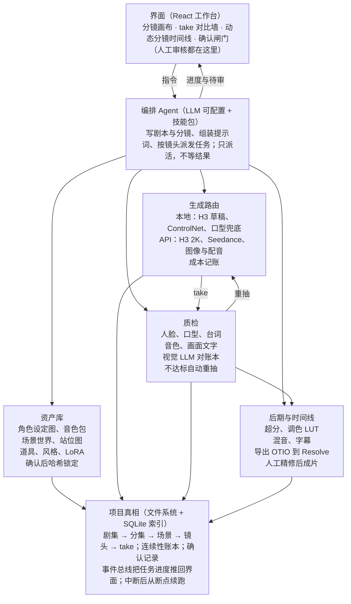
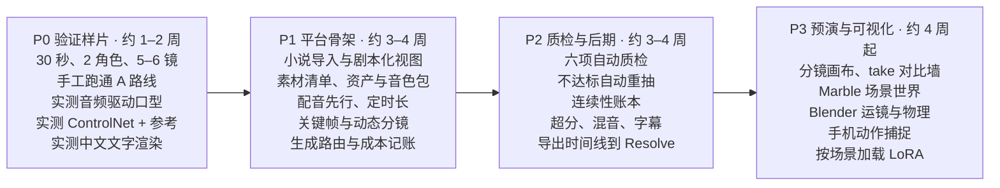

# AI 短剧一体化平台方案

2026-10-14 · Kelvin

> 本文件从方案文档导出，是产品方案的唯一来源。工程实现以 [SPEC.md](SPEC.md) 为准，开发顺序以 [ROADMAP.md](ROADMAP.md) 为准，界面以 [prototype/](prototype/README.md) 为准。

面向会写小说、不会写剧本的创作者。质量优先：主镜头走闭源 API，本地 5090 负责草稿、口型、超分和后期；以 drama-series-agent 的契约、审核和续跑骨架为底，改造成“关键帧先行 + 音频先行 + 资产库 + 自动质检”的一体化平台。

## 总体架构

图：编排 Agent 串起四个模块，人只在确认闸门处介入。

Agent 只负责组装和派活；生成、质检、后期在后台跑，结果写回项目真相，再推回界面等人确认。生成路由和质检之间是自动循环：送检不达标就重抽。

## 工具选型

原则：出现在成片里的东西走质量最高的 API；草稿、试听、质检和后期放在本地 5090。价格为 2026 年 8–10 月公开价，正式预算前再核一次。

| 环节 | 首选 | 本地 / API | 单价 | 理由 |
| --- | --- | --- | --- | --- |
| 剧本、分镜表、提示词 | DeepSeek V4 Pro；便宜档 V4.1 Flash；本地 Qwen3.6 27B | API + 本地 | $0.30–3.96 / 百万 token | 中文写作好又便宜；可一键换 Kimi、通义千问、豆包等，见下表 |
| 角色设定图、场景和动作关键帧 | [Nano Banana Pro](https://www.atlascloud.ai/blog/guides/2026-ai-image-api-benchmark-gpt-image-2-vs-nano-banana-2-pro-vs-seedream-5-0) | API | 约 $0.14/张 | 多参考图下的人物一致性 |
| 带文字的关键帧 | [GPT Image 2](https://www.atlascloud.ai/blog/guides/2026-ai-image-api-benchmark-gpt-image-2-vs-nano-banana-2-pro-vs-seedream-5-0) | API | 约 $0.28/张 | 排版准确率 98.5%，四家里最高 |
| 大量草图 | Seedream 5.0 | API | 约 $0.03/张 | 便宜，用于构图试错 |
| 场景世界（固定空间） | [World Labs Marble](https://invideo.io/blog/world-labs-marble-3d-worlds/) | API | 约 $1.2/个世界 | 可选，只给反复出现的主场景用：生成可漫游 3D 场景，同一地点可从任意机位取景，可导出网格到 Blender |
| 主镜头视频（默认） | [MiniMax H3 官方 API](https://platform.minimax.io/docs/guides/pricing-paygo.md) | API | 768p $0.08/秒，2K $0.13/秒 | 图生视频带音频盲测排名第一，且含官方 Context-IR |
| 主镜头视频（备选） | Seedance 2.5 / Gemini Omni Flash 1.1 / Wan 3.0 | API | $24.60 / $9.12 / $12.00 每分钟 | 与 H3 前几名分差在置信区间内，按镜头类型实测后路由 |
| 草稿视频 | MiniMax H3 本地（Turbo LoRA） | 本地 | 电费 | 不限次抽卡，挑出好构图再花钱 |
| 2K 终版 | H3 Regenerate-2K；或本地 SeedVR2 / FlashVSR | API 或本地 | 输出 $0.05/秒 + 输入视频 $0.05/秒 | 官方支持“本地 768p + 云端重生成 2K”；本地超分只放大、不改内容，不收费 |
| 配音 | [MiniMax Speech 2.8 HD](https://platform.minimax.io/docs/guides/pricing-paygo.md)；英文备选 [ElevenLabs v3](https://invideo.io/blog/ai-voice-model-pricing/) | API | $100/百万字符；音色设计 $3/个，克隆 $1.5/个 | 中文强，可按文字描述设计音色 |
| 配音试听 | Qwen3-TTS | 本地 | 0 | 先本地定音色方向，再用 API 出正式版 |
| 口型兜底 | [sync lipsync-2-pro](https://sync.so/docs/models/lipsync)；本地 InfiniteTalk | API + 本地 | $0.067–0.083/秒 | 原生口型不对时后期重对 |
| 超分（非 H3 镜头） | [Topaz Starlight Precise 2.5](https://invideo.io/blog/topaz-video-enhancement-models/)；本地 SeedVR2（画质好）、FlashVSR（快，10 秒 720p→1080p 约 41 秒） | API + 本地 | 1080p 约 $0.12/秒（按积分换算） | 定位为忠实修复，不乱编细节 |
| 配乐 | [ElevenLabs Music](https://apiframe.ai/blog/ai-music-api-pricing-2026) | API | Creator $22/月，含商用 | MiniMax 音乐 API 自 8 月 20 日起不再对新用户开放 |
| 自动质检 | 人脸相似度、SyncNet、Whisper、说话人相似度、OCR、视觉 LLM | 本地 + API | 0 / 按 token | 见“生产流水线”第 7 步 |
| 剪辑与调色 | DaVinci Resolve（OTIO / FCPXML 导入时间线） | 本地 | 免费版即可 | 平台出时间线，人做最后精修 |

**写作类 LLM：多家可选，默认用便宜好用的**

写作类模型都走 OpenAI 兼容接口，接一家只要填 base URL、密钥和模型名；Claude 等其余模型也能经 OpenRouter 或自定义接口接入。价格是每百万 token 的输入 / 输出，截至 2026 年 10 月 14 日。

| 供应商 | 模型 | 输入 / 输出（每百万 token） | 默认用途 |
| --- | --- | --- | --- |
| DeepSeek | [V4 Pro](https://api-docs.deepseek.com/quick_start/pricing) | $1.32 / $3.96，闲时半价 | 补全、剧本化、分镜规划 |
| DeepSeek | [V4.1 Flash](https://api-docs.deepseek.com/quick_start/pricing) | $0.30 / $1.20，闲时半价 | 分集、批量改写、反复重跑 |
| Moonshot | [Kimi K2.6](https://platform.kimi.ai/docs/pricing/chat) | $0.95 / $4 | 剧本化的第一备选 |
| 阿里云百炼 | [Qwen3.8-max / 3.7-plus / 3.8-flash](https://www.alibabacloud.com/help/en/model-studio/model-pricing) | $2 / $6；$0.40 / $1.60；$0.15 / $0.47 | flash 做设定提取等抽取任务 |
| 火山引擎 | [豆包 2.1 Pro](https://tech.ifeng.com/c/8uBqB6LMgIn) | ¥6 / ¥30 | 备选 |
| 智谱 | [GLM-5.3 / GLM-5.3-Flash](https://docs.z.ai/guides/overview/pricing) | $1.40 / $4.40；$0.15 / $0.50 | 备选 |
| MiniMax | [MiniMax-M3](https://platform.minimax.io/docs/guides/pricing) | $0.30 / $1.20 | 备选，和配音共用账号 |
| Google | [Gemini 3.6 Flash](https://ai.google.dev/gemini-api/docs/pricing) | $0.75 / $3.75，2027 年 1 月 1 日起翻倍 | 视频质检的 API 兜底 |
| OpenAI | [GPT-6 Luna](https://www.eesel.ai/blog/gpt-6-luna-pricing) | 约 $0.10 / $0.50（第三方整理） | 最便宜的一档 |
| OpenRouter | [任意模型](https://openrouter.ai/docs/faq) | 模型原价，充值另收 5.5% | 一个密钥试多家 |
| 本地 | Qwen3.6-27B | 0 | 离线、批量 |

## 生产流水线

一集分 8 步，其中 5 个人工闸门。最关键的是第 5 步的动态分镜：在花视频生成的钱之前，用关键帧加配音把整集先看一遍。

1. **小说到剧本**：导入用户的小说，LLM 补全设定、改编成分集大纲和结构化剧本（见下一节）。**人工确认。**
2. **分镜表与站位**：LLM 拆出场景和镜头，每个镜头标注类型（连续动作 / 同场切镜 / 换场）、出场角色、道具、站位和机位，并写好连续性账本的初始状态。**人工确认。**
3. **资产**：按素材清单生成角色多视角设定图、音色包、场景图和站位图、关键道具。**逐项确认，确认后哈希锁定。**
4. **配音先行**：用音色包生成全部台词，用真实语音时长反推每个镜头的时长，不再靠估算。
5. **关键帧与动态分镜**：每镜生成首帧（需要时加尾帧），带字镜头用 GPT Image 2；关键帧按时长排上时间线，配上台词音频播放。**人工确认整集节奏和构图。**
6. **视频生成**：本地 H3 先出 2–4 个草稿；选定后走 API 出终版（H3 2K 重生成，或按镜头类型路由到备选模型）。连续动作镜头用上一段末尾片段续写，其余镜头都从关键帧起步。
7. **自动质检 + 选片**：每个 take 自动打分——人脸相似度（对参考图）、口型同步（SyncNet）、台词是否念对（语音识别对剧本的字错率）、音色相似度、画面文字（OCR）、站位和道具状态（视觉 LLM 对账本）。不达标自动重抽，达标的并排给人选。**人工选定并锁定。**
8. **后期**：口型兜底 → 超分 → 每场一个调色 LUT → 混音（台词 + 环境声 + 配乐）→ 字幕后期加 → 导出时间线到 Resolve 精修。

## 从小说到素材清单

用户只给小说，平台分 6 步把它变成分镜和素材清单。每一步都产出一份结构化数据，并配一个适合人看和改的视图。

| 步骤 | LLM 做什么 | 产出 | 可视化视图 | 用户能改什么 |
| --- | --- | --- | --- | --- |
| 1. 导入小说 | 按章节切分，抽取人物（含别名）、地点、道具、事件、人物关系 | 故事设定库 | 人物关系图、事件时间线、设定卡片；点卡片高亮原文出处 | 合并或拆分人物、改设定、标出不许改的情节 |
| 2. 补全 | 找出动机不清、时间矛盾、人物前后不一致，给出补写建议 | 带出处的修改建议 | 问题清单 + 原文旁的修订模式 | 逐条接受、改写或拒绝 |
| 3. 改编分集 | 按短剧节奏切集：开头钩子、每集结尾悬念、爽点分布 | 分集大纲 + 节拍表 | 节拍看板（一列一集，节拍卡片可拖动）+ 全剧情绪曲线 | 拖动节拍换集、改钩子、调集数 |
| 4. 剧本化 | 把叙述和描写改写成场景标题、动作行、台词、语气提示 | 结构化剧本（场 → 动作 / 台词） | 原文和剧本左右对照，每场链回原文段落；一键用 TTS 试读一场 | 直接改剧本；圈一句让 LLM 重写这一场 |
| 5. 分镜 | 每场拆镜：景别、机位、出场人物、台词、时长、镜头类型 | 分镜表 | 分镜板（每镜一张低价草图）和表格视图，两者同步 | 改任一字段、重画草图、拆分或合并镜头 |
| 6. 素材分析 | 汇总所有镜头用到的角色造型、场景和时段、道具、音色、画面文字、需要控制视频的难镜头 | 素材清单 + 出场矩阵 | 场景分解表、场景 × 角色出场矩阵；每项标状态（待生成 / 待确认 / 已锁定）和预估成本 | 合并重复项、标优先级、上传自己的参考图 |

**每一步共用的机制**

- **两层表示**：底下是结构化数据，上面是视图。用户在界面上改、或在对话里说“把第三集的反派改成女性”，改的都是同一份数据。
- **LLM 的修改先给差异再生效**：以修订形式显示，人点接受后才写入。
- **溯源**：镜头 → 剧本行 → 小说段落，任一层点击都能跳到另外两层。
- **影响提示**：改上游前先显示会影响几场、几镜、哪些素材，确认后只把这些标为需重做（沿用 drama-series-agent 的失效传播）。
- **闸门**：第 1、3、4、6 步结束各确认一次，确认后哈希锁定。
- **长小说**：按章节分块抽取，再合并人物别名和重复设定，不把整本书一次塞进上下文。
- **版权**：用户上传的小说需要有改编权，导入时让用户确认。

前端组件可用现成开源库：React Flow（关系图、流程画布）、TipTap（带修订的剧本编辑器）、TanStack Table（分解表和分镜表）、wavesurfer.js（音频波形）。

## 每个环节可配置、可重跑

所有环节都由用户决定走本地还是 API、用哪个模型、失败时是否自动兜底；每个产物都能改提示词、重跑、换模型重跑。下表是平台自带的可选项和默认值，用户可以增删。

| 环节 | 本地可选 | API 可选 | 默认 | 自动兜底顺序 |
| --- | --- | --- | --- | --- |
| 小说分析、剧本、分镜（LLM） | Qwen3.6 27B | DeepSeek、Kimi、通义千问、豆包、GLM、MiniMax、Gemini、GPT、OpenRouter、任意 OpenAI 兼容接口 | DeepSeek V4 Pro（抽取类用 Qwen3.8-flash） | → Kimi K2.6 → Qwen3.7-plus → 本地 |
| 关键帧与设定图 | FLUX、Qwen-Image | Nano Banana Pro、GPT Image 2、Seedream 5.0 | Nano Banana Pro；带字镜头 GPT Image 2 | → Seedream 5.0 → 本地 FLUX |
| 视频 | MiniMax H3（完整 / Turbo）、LTX-2.5、Wan 2.2 | H3 API、Seedance 2.5、Gemini Omni Flash、Wan 3.0、Kling | 本地 H3 草稿 + H3 2K 重生成 | → H3 API → Seedance 2.5 |
| 配音 | Qwen3-TTS、CosyVoice、IndexTTS2 | MiniMax Speech、ElevenLabs、Seed TTS | MiniMax Speech 2.8 HD | → ElevenLabs → 本地 |
| 口型 | InfiniteTalk | sync lipsync-2-pro / sync-3 | lipsync-2-pro | → 本地 InfiniteTalk |
| 超分 | SeedVR2、FlashVSR、RTX 视频超分 | H3 2K 重生成、Topaz Starlight Precise | 本地 SeedVR2；要补细节时用 H3 2K 重生成 | → FlashVSR → H3 2K 重生成 |
| 配乐 | — | ElevenLabs Music | ElevenLabs Music | 无 |
| 质检 | 人脸、SyncNet、Whisper、OCR | 视觉 LLM（Gemini 3.6 Flash、Gemini 3.1 Flash-Lite） | 本地 Qwen3-VL-32B | → Gemini 3.6 Flash |
| 场景世界 | Blender 手搭 | Marble | 关闭 | 无 |

**配置和重跑规则**

- **三级配置**：项目默认 → 环节默认 → 单个镜头（或单个素材）覆盖。界面上标出当前值来自哪一级。
- **每个产物卡片的四个按钮**：改提示词、重跑（同模型换种子）、不满意换一个（选另一个模型重跑，输入不变）、对比历史版本。新结果作为新 take 并排显示，旧的不覆盖。
- **提示词分两层**：意图层（中文，和模型无关）和编译层（按目标模型格式生成，如 H3 六段式）。两层都能改；手改编译层会标“手动覆盖”，上游变化时询问是否保留。换模型时由意图层重新编译。
- **自动兜底**：每个环节一个开关。触发条件为调用失败、超时、或质检连续 N 次不达标（N 由用户设）；按顺序切到下一个，每次切换记在 take 上。
- **能力过滤**：只列出满足当前镜头需求的模型（参考图数量、时长、音频驱动、控制视频）。ControlNet 镜头只显示本地模型。
- **费用可见**：按钮上显示预估费用和耗时；每个环节和每集可设预算上限，超限暂停等确认。
- **重跑范围**：重跑一项只影响它自己；上游改动按失效传播只重做受影响的项。
- **实现方式**：每个模型一个适配器，统一输入输出并声明能力（支持的参考数、时长、是否支持音频和控制视频、单价）；新增模型只加适配器，不动流程。写作类 LLM 统一走 OpenAI 兼容协议，用一张供应商表（base URL、密钥、模型名、单价）管理，新模型填表就能用；界面先列常用 6 家，其余收进「更多供应商」。

## 首次启动：主机检测与自动安装

第一次打开先扫描主机，列出缺的环境、节点和模型，用户勾选后一键装好，再按硬件推荐预设。交互见原型「00 首次启动」画板。

| 检测项 | 检测什么 | 缺了怎么处理 |
| --- | --- | --- |
| 硬件 | 显卡型号和显存、驱动支持的 CUDA 版本、内存、磁盘剩余 | 决定哪些组件能本地跑；Apple 芯片把视频、关键帧、超分自动切到 API |
| 运行环境 | Python、uv、PyTorch 的 CUDA 版本（NVFP4 需要 CUDA 13.0 版）、FFmpeg、Git | 用 uv 建独立环境安装，不动系统 Python |
| ComfyUI 与节点 | ComfyUI 版本；H3、VideoHelperSuite、SeedVR2、FlashVSR、Fun ControlNet 节点；SageAttention | 按清单锁定版本安装；可选项失败只记录，不阻塞 |
| 模型权重 | H3、Qwen3-VL 文本编码器、Qwen-Image-Edit、SeedVR2、IndexTTS2、本地 LLM | 断点续传，下载后校验哈希 |
| 网络与服务 | 到 Hugging Face、GitHub、PyPI 的速度；本地 LLM 服务（Ollama / llama.cpp）；已填的 API 密钥 | 自动测速选源，可手动切国内镜像；密钥之后在设置里填 |

- **清单驱动**：一个 manifest 文件列出每个组件的检测方法、版本要求、安装步骤、依赖和适用平台；加组件只改清单，不改安装器代码。
- **先只读检测**：扫描不改动任何东西，结果存成机器档案；路由器据此隐藏这台机器跑不了的本地选项。
- **安装**：按依赖顺序执行，日志实时显示；每步可重试或跳过；装过的东西记录在案，卸载能清干净；重新检测只补差异。
- **平台**：Windows（原生，可选 WSL2）、Linux、macOS。Apple 芯片只装 LLM、配音和工具，视频类组件默认走 API。

**界面语言**：中文 / English 一键切换。界面文字全部放在 i18n 词表（如 i18next），不写死在组件里。提示词意图层跟随用户的语言，编译层按目标模型需要的语言生成。

## 数据看板与埋点

看板回答三件事：钱花在哪、时间花在哪、哪个模型又快又便宜。所有数字都来自同一张调用记录表，原型见「数据看板」画板。

| 看板模块 | 回答的问题 | 怎么算 |
| --- | --- | --- |
| 预算条 + 值得注意 | 本集 / 全剧花了多少，还要多少，会不会超预算 | 已花 = 调用记录汇总；还要 = 剩余镜头 × 当前路由单价 |
| 关键指标 | 已采纳成片秒数、每秒成片成本、本地 GPU 时长、API 成功率、质检通过率、镜头从开始到采纳的时长 | 调用记录 + take 状态 |
| 累计花费曲线 | 花费随时间怎么涨，哪一段花得最多 | 按 15 分钟汇总，虚线是预测 |
| API 调用次数 | 调用频率，文本 / 图像 / 音视频各多少，失败和限流 | 按 15 分钟和类别汇总 |
| 每个镜头的时间和钱 | 按场分组，每个镜头在关键帧、视频生成、质检精修上各花多久，几条候选，花多少 | 按镜头 × 环节汇总 |
| 各组件计算时长 | 哪个组件最耗时，本地跑了多久、等 API 多久 | 按组件 × 本地 / API 汇总 |
| 生成速度 | 每个模型出 1 秒成片要算多少秒（中位、最快、最慢） | 视频类调用耗时 ÷ 输出秒数 |
| API 明细 / 本地模型明细 | 每个 API 的调用、成功率、中位耗时、用量、花费；每个本地模型的次数、时长、显存峰值 | 调用记录 + 本地运行时的显存采样 |
| 质检 / 按集汇总 | 通过率和没过的原因；每集进度、已花和预计 | take 的质检结果、分集表 |

**埋点：每次模型调用写一行记录**，本地和 API 一样：

- **归属**：项目、集、场、镜头、环节、组件、产物版本
- **模型**：供应商、模型名、本地 / API、是否兜底及原因、是否「不满意换一个」
- **时间**：进队列、开始、结束；本地任务另记显存峰值和 GPU 占用
- **用量**：输入 / 输出 token、图片张数、视频秒数、字符数
- **花费**：按供应商表的单价现算，并存下当时的单价；以后改价，历史花费不变
- **结果**：成功 / 失败（错误码，如 429）/ 超时 / 取消；质检各项分数和是否通过

记录存在本地 SQLite，看板直接查询汇总，可导出 CSV。预算上限也读这张表：单次、单镜头、单集超限就暂停等确认。每张图都有对应的表格视图。

## 成片规格：横版还是竖版

新建剧集时先定，全剧共用。画幅决定所有关键帧和视频的构图，第一张关键帧采纳后锁定。交互见原型「00b 成片规格」画板。

| 项 | 选项 | 默认 | 说明 |
| --- | --- | --- | --- |
| 发布平台 | 国内短剧（抖音、快手、视频号、红果短剧）/ 海外短剧 App（ReelShort、DramaBox、TikTok）/ 横屏平台（B 站、YouTube）/ 自定义 | 国内短剧 | 选平台自动填好画幅和分辨率 |
| 画幅 | 9:16、16:9、3:4、1:1、21:9 | 9:16 竖版 | 短剧平台以竖屏为主 |
| 交付分辨率 | 1080p（9:16 为 1080×1920）/ 2K（1440×2560） | 1080p | 草稿固定用 768p 档在本地抽卡；选 2K 时终版多一步精修 |
| 帧率 | 24 / 25 / 30 fps | 24 | H3 原生 24 fps；25、30 只在导出时转换，30 需要插帧 |
| 每集时长 | 30–90 秒 / 1.5–3 分钟 / 3–5 分钟 / 10 分钟左右 | 30–90 秒 | 分集规划按这个时长切集 |
| 声音 | 48 kHz，响度 -14 LUFS，峰值 -1 dBTP | — | 后期混音的目标 |
| 字幕 | 烧进画面 / 单独 SRT / 两样都要 | 两样都要 | 放在平台遮挡区以上 |
| 导出 | MP4 H.264，Rec.709 SDR；AI 生成标识（角标 + 元数据） | 标识开 | 国内平台要求标识 |

- **跟着规格走的地方**：关键帧和视频的尺寸、提示词里的画幅、分镜和关键帧页的安全区参考线（平台按钮、标题和进度条会挡住的地方）、超分目标、导出预设、ComfyUI 节点输出的宽高。
- **模型兼容检查**：按当前路由检查每个模型能不能直接出这个规格。H3 支持 21:9 到 9:16 共 6 种画幅、24 fps、单段 5–15 秒；Nano Banana Pro 不支持 21:9；GPT Image 2 部分渠道 9:16 只到 1K，要再超分；Seedance 2.5 部分渠道只到 720p。不支持的模型在选择器里隐藏，需要转换的标出来。
- **改规格**：改帧率或分辨率只影响精修和导出；改画幅要重做所有关键帧和视频，先弹出影响范围和预计花费，走同一套失效传播。
- **另出一版**：竖版主片可在导出时用 AI 把两侧外扩成横屏版（另计费）；横版主片可按人物位置自动裁成竖屏（不花钱）。

## 素材整理与外部画布

平台自己的界面管流程和状态；看图、排图、接着做，交给更顺手的软件。生成的素材按集、场、镜头自动整理好推过去，交互见原型「素材整理与同步」画板。

| 目标 | 方向 | 怎么做 | 限制 |
| --- | --- | --- | --- |
| ComfyUI 画布 | 双向 | 每集生成一张「素材板」工作流：角色、场景、道具和各场镜头分组摆好，Load Image / Load Video / Load Audio 节点指向文件，便签写提示词、模型、花费和质检分，存进 ComfyUI 的工作流列表。自带节点包 DramaStudio：「镜头」节点读出某镜已锁定的关键帧、台词音频、参考图、提示词和尺寸，可直接连进自己的工作流；「存回工作台」节点把结果存成这个镜头的新候选 | 画布里挪节点、改分组不回写；ComfyUI 自带的素材面板没有文件夹和标签 |
| 本地文件夹 | 单向 | 剧 / 集 / 场 / 镜头分目录，文件名带版本号，旁边放同名 .json（提示词、模型、花费、质检分） | — |
| Eagle | 单向 | 用 Eagle 本地 API 建文件夹、打标签（角色、场景、状态、模型），提示词写进注释 | 付费软件，要先安装并打开 |
| 达芬奇 Resolve | 单向 | 免费版：导出整理好的文件夹和 FCPXML，手动导入，按文件夹建 Bin。Studio 版：用 Python API 自动建 Bin、写元数据和标记 | 免费版从 21.1 起不再支持外部 Python 脚本 |

- **同步时机**：采纳或锁定时（默认）/ 每次生成 / 只手动；同步哪些类型可以勾选。
- **以工作台为准**：外部软件里的改动不会改工作台的数据。只有「存回工作台」节点会产生新版本，而且只是候选，自动跑质检、记调用，不会顶掉已采纳的版本。
- **之后再做**：把 ComfyUI 画布里的分组变化回写成标签。云端节点画布（Flora、Figma Weave、Krea 等）要把素材传到第三方云，也没查到公开的导入接口，暂不接。

## 音画一致性

默认“音频先行”：台词先由锁定的音色包生成，再让画面跟着音频走。声音从此不再随每次视频生成漂移，台词时长也能提前定下镜头节奏。

| 模式 | 做法 | 用在 | 风险 |
| --- | --- | --- | --- |
| A. 音频驱动（默认） | 把本镜台词音频作为 H3 的 `<Audio N>` 输入，在 retention\_analysis 里标为整段引用（fully\_copy），让口型跟随给定音频 | 对白镜头 | 需在第一阶段实测口型贴合度；单段音频 2–15 秒 |
| B. 原生生成 + 音色参考 | 给 4–6 秒音色样本（内容和目标台词不同），提示词写“只参考音色”，每个说话人固定编号（S1、S2） | 情绪张力大、要呼吸和语气的镜头 | 音色漂移、台词安到别人嘴上，双人对白约需 2 次重抽 |
| C. 后期对口型（兜底） | 画面先生成，再用 TTS 音轨跑 lipsync-2-pro 或 InfiniteTalk | A、B 都不达标的镜头 | 多人同框时质量下降 |

**音色包（每个角色一套）**

- 先用文字描述设计一个中性音色作为锚点：本地 Qwen3-TTS 试听定方向，再用 MiniMax 音色设计出正式版。
- 从锚点派生 4–5 个情绪变体：平静、愤怒、哭腔、耳语、喊叫。
- 统一采样率和响度，切掉首尾静音；确认后哈希锁定，和角色设定图同等地位。
- 真人配音只用签了授权的演员；不克隆真人或名人。

**质检三项（每个 take 自动跑）**

- 台词：语音识别结果和剧本比字错率，抓错词、漏词和乱码音。
- 音色：和音色包做说话人相似度，抓音色漂移和串音。
- 口型：SyncNet 置信度，抓嘴型对不上。

**声音的其余部分**

- 配乐一律后期加，H3 的 non\_diegetic\_music 写 N/A；否则每个镜头换一种配乐。
- 每场铺一条环境声底层，切镜处用音频先入或延后（J-cut / L-cut）盖住接缝。
- 每镜开头切掉约 0.3 秒，避开 H3 开头偶发的乱码音。

## 画面文字

文字不交给视频模型自由发挥：字幕全部后期加，场景里的字先在关键帧里画对，关键文字后期合成，最后用 OCR 核对。

| 文字类型 | 例子 | 做法 |
| --- | --- | --- |
| 字幕、片名、人名条 | 对白字幕、集数标题 | 模型不生成；提示词写明“画面内无文字”，字幕由语音识别对齐后在剪辑时加 |
| 背景里的字 | 店招、门牌、海报 | 用 GPT Image 2 生成含字的关键帧或场景图，引号写出确切文字；视频从该帧起步，镜头运动保持缓慢 |
| 剧情关键文字 | 手机消息、合同、屏幕界面 | 视频里留空白屏幕或纸面，后期用平面跟踪（Resolve Fusion 的 Planar Tracker）贴上真实文字 |
| 道具上反复出现的字 | 招牌、警徽、书名 | 做成道具参考图，作为固定的 `<Picture N>` 在所有镜头里引用 |

- 文字尽量少而大，单块不超过一行；小字体和密集段落各家都不稳。
- 质检：关键帧和视频每秒抽一帧做 OCR，和分镜表里的预期文字比对；不一致就重生成或改走后期合成。
- 中文没找到公开评测：第一阶段用 20 张自己的中文招牌和界面样例，实测 GPT Image 2、Nano Banana Pro、Seedream 5.0 后再定默认。

## 空间与物理

不只能靠模型。按镜头难度分级加控制：普通镜头靠提示词和关键帧，越难的镜头越多地用 3D 场景、动作捕捉和物理模拟生成“控制视频”，再用 H3 的 Fun ControlNet Union（支持 Canny、深度、HED、MLSD、姿态）去约束生成。

| 镜头难度 | 例子 | 控制手段 |
| --- | --- | --- |
| 1. 普通对话 | 两人坐着说话 | 站位图 + 提示词写清左右和朝向 + 关键帧 |
| 2. 同一空间多机位 | 正反打、全景切近景 | 用 Marble 生成该场景的 3D 世界，各机位的背景都从同一空间渲染出来再做关键帧 |
| 3. 复杂运镜 | 环绕、穿过门的跟拍 | Marble 网格导入 Blender，打相机路径，渲染深度视频作为控制 |
| 4. 人的身体动作与接触 | 打斗、拥抱、摔倒 | 自己或演员用手机录一遍，提取姿态骨架作为控制；真人动作自带合理的重心和发力 |
| 5. 物体碰撞与破坏 | 杯子摔碎、车撞、布料飘动 | Blender 刚体 / 布料 / 粒子模拟，用简单替代物跑出合理轨迹，渲染深度或边缘视频作为控制 |
| 6. 现实里没有的特效 | 爆炸、法术 | 单独生成素材，后期合成 |

- 规划阶段就减少出错：每镜只安排 1 个主动作、写清至少两个空间关系、遵守 180 度轴线（沿用 drama-series-agent 技能里的“动作预算”规则）。
- 控制视频只能在本地 ComfyUI 用：第 3–5 级镜头走本地 H3 + ControlNet，再用官方 2K 重生成提画质。身份参考和 ControlNet 同时使用的效果官方没有说明，需要实测。
- 质检：视觉 LLM 对照连续性账本检查左右站位、手中道具、接触关系，并标出穿模、悬浮、物体变形。

## 基于 drama-series-agent 的改造

可以在它上面做：它的工程骨架（契约、确认闸门、事件总线、续跑）成熟，要重写的是镜头契约、衔接和调度。仓库为 Apache 2.0，内置的剧本技能包为 MIT，都可以改和商用；但它只有 7 次提交，建议 fork 后自己维护。

| 模块 | 处理 | 说明 |
| --- | --- | --- |
| 文件系统为唯一真相、运行状态文件 | 保留 | 加一个 SQLite 索引，方便界面查询 |
| 哈希确认、失效传播、决策记录 | 保留 | 覆盖范围扩展到音色包、场景、关键帧 |
| 事件总线、任务事件、断点续跑、逐镜审核与锁定 | 保留 |  |
| 技能分层、提示词黑名单校验 | 保留 |  |
| 镜头契约（episode-run.jsonl） | 改造 | 增加镜头类型、场景和道具参考、关键帧、台词音频及模式（A/B/C）、控制视频、生成路由、多个 take 及质检分 |
| 首帧来源 | 改造 | 增加“生成的关键帧”和“上一段末尾片段续写”；删掉“第 2 镜起必须用尾帧”的校验 |
| “每镜必须有台词”、每集 3 角色 16 镜上限 | 改造 | 静音镜头改为写清环境声；上限改为配置项 |
| 本地 Context-IR | 重写 | 删掉硬编码的七龙珠约束；改为 LLM 按官方指南生成，或调官方 API（输入 $0.90、输出 $3.60 每百万 token） |
| 渲染调度（runner） | 重写 | 从串行链改为按依赖图调度；用同一套模型的镜头连续跑，不再每镜卸载 |
| 资产库 | 扩展 | 从只有角色图，扩展到角色、音色包、场景世界与站位图、道具、风格（LUT、LoRA、提示词嵌入） |
| 生成路由与成本记账 | 新增 | 统一接口对接本地 ComfyUI、H3 API、备选视频 API、图像和 TTS API |
| 配音引擎、关键帧与动态分镜 | 新增 | 对应流水线第 4–5 步 |
| 连续性账本 | 新增 | 每场每镜的站位、道具、服装、时间状态，结构化 JSON |
| 质检与自动重抽 | 新增 | 对应流水线第 7 步 |
| 预演（Marble、Blender 脚本、姿态提取） | 新增 | 对应“空间与物理”第 2–5 级 |
| 后期（超分、LUT、混音、字幕、时间线导出） | 新增 | 导出 OpenTimelineIO / FCPXML 给 Resolve |
| 界面 | 扩展 | 在现有 React 工作台上加分镜画布、take 对比墙、动态分镜时间线 |

数据层级：剧集 → 分集 → 场景 → 镜头 → take；资产（角色、音色包、场景、道具、风格）挂在剧集下，镜头只引用资产 ID。

## 成本估算

每分钟成片的算力和 API 约 $15–80，取决于终版走哪条路；真正的大头是你审片和调整的时间。以下为我的估算，假设 1 分钟 = 8 个镜头×约 7.5 秒，每镜 4 张候选关键帧。

| 项目 | A. 本地草稿 + H3 2K 重生成 | B. 全部 H3 API 2K（每镜 3 个 take） | C. Seedance 2.5（每镜 3 个 take） |
| --- | --- | --- | --- |
| 关键帧（32 张 × 约 $0.14） | $4.5 | $4.5 | $4.5 |
| 视频 | 约 $7.8（$0.10/秒 × 60 秒 × 1.3 次返工） | 约 $23.4（$0.13/秒 × 180 秒） | 约 $73.8（$24.60/分钟 × 3） |
| Context-IR | 不到 $0.5 | 不到 $0.5 | — |
| 配音 | 不到 $0.1 | 不到 $0.1 | 不到 $0.1 |
| 口型兜底（约 20% 时长） | 约 $1 | 约 $1 | 约 $1 |
| LLM 与视觉质检 | 约 $1–3 | 约 $1–3 | 约 $1–3 |
| **每分钟合计** | **约 $15** | **约 $30** | **约 $80** |
| **10 分钟一集** | **约 $150** | **约 $300** | **约 $800** |

- 一次性或订阅：每个音色设计 $3，每个场景世界约 $1.2，配乐订阅 $22/月。
- 参照：国内 AI 仿真人剧市场报价 2000–6000 元/分钟，其中人力约占 70%。
- 建议默认走 A，只有 H3 做不好的镜头类型（由第一阶段实测确定）路由到 C。

**和纯 API 比**

| 做法 | 每分钟成片（估算） | 差别在哪 |
| --- | --- | --- |
| 纯 API：Seedance 2.5，每镜抽 3 次 | 约 $80 | 单价约为 H3 2K 的 3 倍 |
| 纯 API：H3 2K，每镜抽 3 次 | 约 $30 | 每次抽卡都付费 |
| 本方案 A（加上下面的降本项） | 约 $10–15 | 抽卡在本地免费，只给选中的 take 付 2K 费用 |

- 省的钱主要来自视频：同样每镜抽 3 次，A 比纯 H3 API 每分钟省约 $15。已有 5090 的话这部分几乎是净省。
- 降本项：关键帧候选改用 Seedream 5.0（约 $0.03/张）或本地 FLUX，只有定稿那张用 Nano Banana Pro，关键帧从约 $4.5 降到约 $2；批量改写用本地 LLM。
- 场景世界不在每分钟成本里：一个世界约 $1.2，一部剧几个主场景合计十几美元。
- 参照：从业者的算力成本约 1–3 元/秒，单轮每分钟 60–180 元（约 $8–25），再乘 2–5 轮迭代；本方案已含迭代，仍在这个量级。真正贵的是人工，可视化和自动质检就是为了压这部分。
- 纯 API 的好处：不用维护本地环境，也不受 H3 本地权重许可限制；代价是抽卡全付费，且用不了 ControlNet 和自训 LoRA。

## 路线图

| 阶段 | 进入下一阶段的闸门 |
| --- | --- |
| P0 验证样片 | 样片达到你认可的质量；定下默认模型路由；每项实测有结论 |
| P1 平台骨架 | 3 分钟一集全程走平台，人只在闸门处介入 |
| P2 质检与后期 | 10 分钟一集出片；多数问题镜头被自动拦下；返工率可度量 |
| P3 预演与可视化 | 复杂运镜和打斗镜头能稳定出片 |

时长为一人开发的估算。工程上的里程碑拆分和验收标准见 [ROADMAP.md](ROADMAP.md)。

先花 1–2 周手工做一个 30 秒样片，把三个未验证假设测完再写平台代码；之后每个阶段结束都能完整出一集，可以随时停在任一阶段。时长是按一个人业余开发的估算。

P1 的第一件事是主机检测和安装器，第二件是新建剧集时的成片规格；界面从第一天起走 i18n 词表，避免后面返工。

## 风险与待定问题

**风险**

- **未验证的关键假设**：音频驱动模式的口型贴合度、ControlNet 与身份参考同时使用的效果、中文文字渲染。都放在第一阶段实测，不达标就改用兜底方案。
- **H3 已知问题**：开头偶发乱码音；双人对白时台词安错人。对策见“音画一致性”。
- **模型和价格每月在变**：视频榜前七名分差在置信区间内，Kling 4.0 和 Vidu Q4 正在上线。生成路由层必须可替换，每月用自己的测试镜头复测一次。
- **H3 本地权重的许可**：美国不在社区许可的授权地区；ComfyUI 文档也说本地生成内容商用需要 MiniMax 商业授权。正式发布前要解决，否则终版全部走 API。
- **H3 LoRA 训练工具仍是实验性的**：musubi-tuner 和 ai-toolkit 升级后可能失效，版本要锁定。
- **内容合规**：中国平台强制 AI 标识并要求备案；不用未授权的真人肖像和声音。
- **工程量**：一个人做全套平台工作量大，按路线图分阶段交付，每阶段都能独立出片。

**待定问题**

- 目标市场是国内平台还是出海？影响语言、配音选型和合规要求。
- 画风是仿真人还是漫剧？影响视频模型路由和是否需要风格 LoRA。
- 每集时长和更新节奏？决定审片工作量和是否要加人。

## 来源

- [MiniMax 开放平台按量计费（H3、Context-IR、重生成、语音、音色设计）](https://platform.minimax.io/docs/guides/pricing-paygo.md)
- [MiniMaxAI/MiniMax-H3 模型卡](https://huggingface.co/MiniMaxAI/MiniMax-H3)
- [Artificial Analysis 图生视频榜](https://artificialanalysis.ai/video/leaderboard/image-to-video)
- [ComfyUI：MiniMax H3 概览](https://docs.comfy.org/tutorials/video/minimax/minimax-h3) · [原生节点](https://docs.comfy.org/tutorials/video/minimax/minimax-h3-native) · [多帧参考](https://docs.comfy.org/tutorials/video/minimax/minimax-h3-multiframe) · [Fun ControlNet Union](https://docs.comfy.org/tutorials/video/minimax/minimax-h3-fun-controlnet) · [提示词指南](https://docs.comfy.org/tutorials/video/minimax/minimax-h3-prompt-guide)
- [Atlas Cloud：2026 图像 API 评测](https://www.atlascloud.ai/blog/guides/2026-ai-image-api-benchmark-gpt-image-2-vs-nano-banana-2-pro-vs-seedream-5-0)
- [invideo：TTS 价格对比（2026 年 8 月）](https://invideo.io/blog/ai-voice-model-pricing/)
- [sync.so：lipsync 模型与价格](https://sync.so/docs/models/lipsync)
- [invideo：World Labs Marble](https://invideo.io/blog/world-labs-marble-3d-worlds/)
- [invideo：Topaz 视频增强模型](https://invideo.io/blog/topaz-video-enhancement-models/)
- [Apiframe：AI 音乐 API 价格](https://apiframe.ai/blog/ai-music-api-pricing-2026)
- [Atlas Cloud：H3 口型与音频](https://www.atlascloud.ai/blog/guides/minimax-h3-lip-sync-and-audio)
- [Hugging Face：H3 开头乱码音讨论](https://huggingface.co/MiniMaxAI/MiniMax-H3/discussions/76)
- [musubi-tuner：MiniMax-H3 支持路线图](https://github.com/kohya-ss/musubi-tuner/issues/1029)
- [drama-series-agent](https://github.com/binwu1/drama-series-agent)
- [财联社：AI 仿真人剧成本](https://www.cls.cn/detail/2308317)
- [DeepSeek API 价格](https://api-docs.deepseek.com/quick_start/pricing)
- [Kimi API 价格](https://platform.kimi.ai/docs/pricing/chat)
- [阿里云百炼模型价格](https://www.alibabacloud.com/help/en/model-studio/model-pricing)
- [智谱 GLM 价格](https://docs.z.ai/guides/overview/pricing)
- [MiniMax 价格（M3、Speech 2.8）](https://platform.minimax.io/docs/guides/pricing)
- [Gemini API 价格](https://ai.google.dev/gemini-api/docs/pricing)
- [凤凰科技：豆包 2.1 Pro 定价](https://tech.ifeng.com/c/8uBqB6LMgIn)
- [eesel：GPT-6 Luna 价格](https://www.eesel.ai/blog/gpt-6-luna-pricing)
- [OpenRouter FAQ（费用与兼容性）](https://openrouter.ai/docs/faq)
- [ComfyUI：视频超分（SeedVR2、FlashVSR 速度对比）](https://docs.comfy.org/tutorials/utility/video-upscale)
- [ComfyUI-FlashVSR 节点](https://www.runcomfy.com/comfyui-nodes/ComfyUI-FlashVSR)
- [Morphic：MiniMax H3 规格（画幅、分辨率、帧率、输入限制）](https://morphic.com/resources/models/minimax-h3)
- [Apiframe：Nano Banana Pro 支持的画幅](https://apiframe.ai/models/nano-banana-pro)
- [EvoLink：GPT Image 2 尺寸与画幅](https://evolink.ai/docs/en/api-manual/image-series/gpt-image-2/gpt-image-2-beta-image-generation.md)
- [fal：Seedance 2.5 与 2.0 对比](https://fal.ai/learn/devs/seedance-2-5-vs-seedance-2-0)
- [ComfyUI：素材面板（Assets）](https://docs.comfy.org/interface/assets)
- [Eagle API：addFromPath](https://api.eagle.cool/item/add-from-path)
- [Resolve 脚本 API 说明](https://resolvedevdoc.readthedocs.io/en/latest/readme_resolveapi.html)
- [DaVinci Resolve 21.1 免费版移除 Python 脚本](https://xere.my/journal/davinci-resolve-21-1-free-python-scripting-removed-lua-benchmark/)
