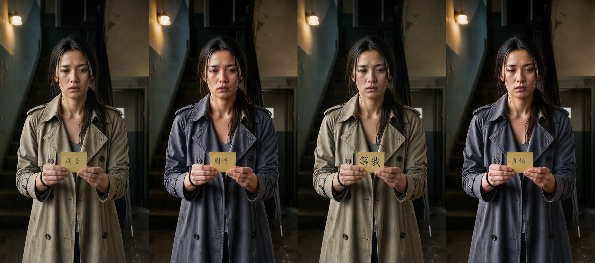
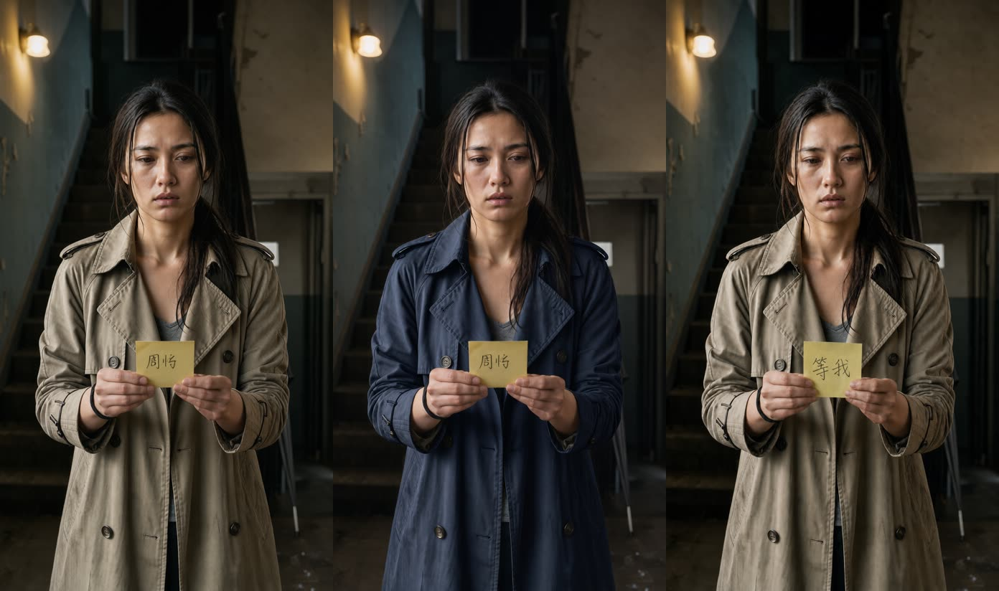

# M5.5 第 18 步：图片编辑本机核对和 API 冒烟（2026-11-14）

脚本 `scripts/smoke/live_edits.py`，日志 [`report.txt`](report.txt)。原图（全尺寸 PNG / JPEG、遮罩）在 Kelvin 本机
`docs/studio/reports/m5-local-smoke/originals/m55-edits/`，不进 git；这里只放对照图。

```bash
uv run --no-sync python scripts/smoke/live_edits.py --only check,local      # 不花钱：只用本机 ComfyUI
DRAMA_LIVE=1 uv run --no-sync python scripts/smoke/live_edits.py --cap 1    # 再加两张 API 图（约 $0.23）
```

## 做了什么

底图是第二十轮 1-04 的关键帧（林晚拿着便利贴，便利贴上的字是乱的「周愣」），按 1-04 的首帧上传（裁成 9:16、缩到 1080×1920）。

| 步骤 | 模型 | 结果 | 用时 |
| --- | --- | --- | --- |
| 体检 + 试跑 | `flux3-klein-redraw`、`klein-inpaint`、`seedvr2-img` | 三个都「正常」，试跑都通过（768×1366） | 13.7 / 7.2 / 4.6 s |
| 本地重画（改动幅度 0.5）：风衣换成深海军蓝 | FLUX 3 Klein | 风衣变深蓝灰，脸、姿势、场景、便利贴不变；928×1664 | 15.7 s |
| 本地局部修复：遮住便利贴，写「等我」 | Klein + 遮罩 | 字写对了，遮罩外像素不变；928×1664 | 8.6 s |
| 本地放大：上面那张重画 → 1080×1920 | SeedVR2 7B | 只补细节、不改内容 | 5.0 s |
| API 重画（同样的要求） | Nano Banana 2.1 | 海军蓝风衣，其余不变；1536×2752 JPEG | 18.2 s · $0.0527 |
| API 局部修复（同一张遮罩） | GPT Image 2 | 字写对了；遮罩只是引导，便利贴和手指被轻微重画；1088×1920 | 63.0 s · $0.1718 |

合计 $0.2245（上限 $1），8 次 `model_call` 全部成功，本地的几次都没有兜底到 API。用时是模型已经加载好的情况（前面试跑加载过）。






## 发现的问题

- **冒烟脚本里工作流库默认连的是示例机器**：临时数据目录里的工作台没有扫描过这台电脑，工作流库用示例机器的节点表（`wflib/demo/object_info.json`），把 `ImageScale`、`VAEEncode` 等 ComfyUI 自带节点报成「找不到」。脚本里把工作流库接到本机 ComfyUI 后就都正常了；正式工作台（`start.ps1` 默认 `-RealSetup`）扫描后本来就连本机，不受影响。
- 本地重画和局部修复出来的是 Klein 的尺寸 928×1664（和本地草稿一样），要交付尺寸再点「放大」；API 两家按自己的尺寸出（Nano Banana 2.1 是 2K、GPT Image 2 宽高要 16 的倍数所以是 1088×1920），和关键帧「用 API 出终版」一致，视频按成片规格缩放。没改。
